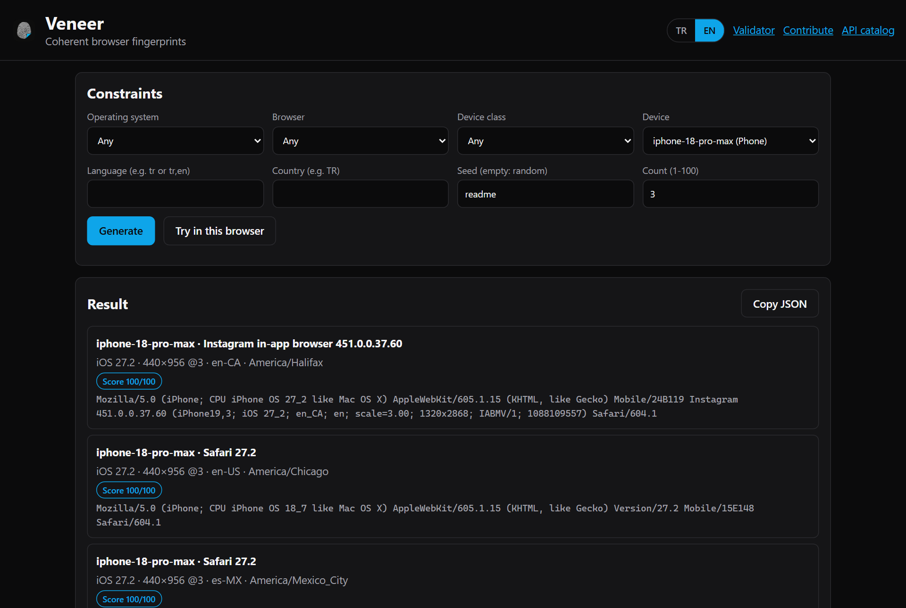
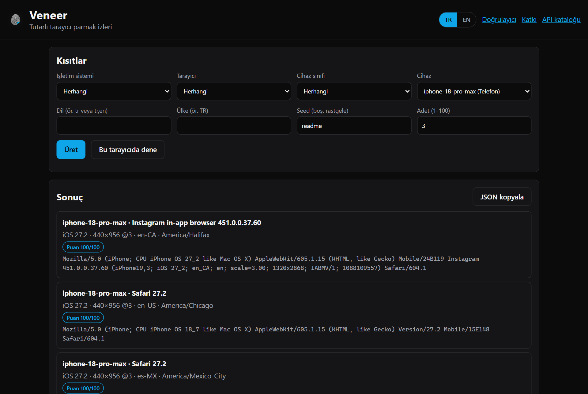
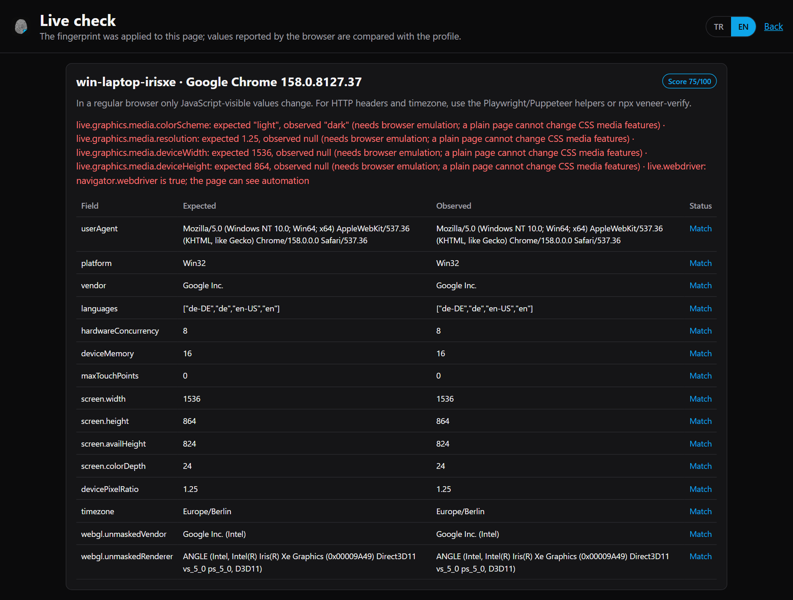
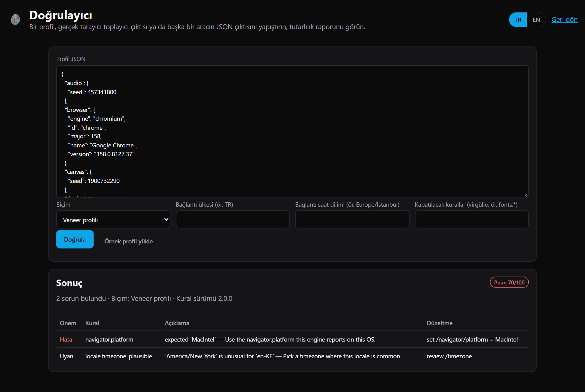
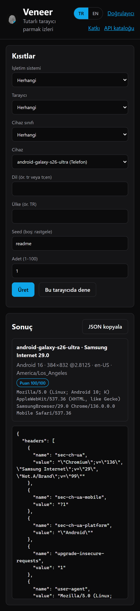

<p align="center">
  
</p>

<h1 align="center">Veneer</h1>

<p align="center">
  <strong>Coherent browser fingerprints for Playwright, Puppeteer, Selenium and more.</strong><br>
  User agent, client hints, screen, WebGL, canvas, audio, fonts, locale, timezone and HTTP headers generated as one believable, internally consistent profile — and verified in a real browser. Rust core, WASM, a cross-platform CLI with a local HTTP API, and bindings for JavaScript, Python, Go, .NET and Java.
</p>

<p align="center">
  <a href="LICENSE"></a>
  
  
  
  
  
</p>

<p align="center">
  <b>English</b> · <a href="README.tr.md">Türkçe</a>
</p>

<table>
  <tr>
    <td width="50%"></td>
    <td width="50%"></td>
  </tr>
  <tr>
    <td align="center">English interface</td>
    <td align="center">Turkish interface</td>
  </tr>
</table>

---

## Why Veneer

Most fingerprint tools randomize each attribute on its own. The result is a Windows user agent with an Apple GPU, a 4K screen on a phone, Safari 27 on an iPhone 8, or an `en-US` browser in `Asia/Tokyo`. Detection systems do not need to look at any single value — they look at the **contradictions** between them.

Veneer picks a real device, browser and OS version together, then derives every value from that combination. A validator proves it: on every run the test suite generates profiles for every OS, every browser and every device and fails on a single inconsistency, and an end-to-end suite launches real browsers and checks what pages — including FingerprintJS — actually see.

| | Per-attribute randomizers | Veneer |
| --- | --- | --- |
| Generation | Independent random picks | Joint sampling of real device + browser + OS version |
| Dataset | Hand-written lists | 129 devices, 24 browsers, 80 locales, 7.0 million distinct configurations, every value sourced |
| Consistency | None, or ad-hoc checks | 60+ named rules with fixes, enforced in CI |
| Live verification | Manual | Collector + comparison in a real browser, request-header check, FingerprintJS cross-check |
| Freshness | Manual updates | Weekly job pulls versions from official Chrome, Edge and Firefox feeds |
| Runtime | One language | Single native binary (Windows, Linux, macOS), Rust crate, npm, Python, Go, .NET, Java |

## Features

- **Every device class, oldest to newest.** iPhone 7 → iPhone 18 Pro Max; Galaxy S10 → S26 Ultra and Z Fold8 / Fold8 Ultra (folded and unfolded); Pixel 6 → 10; Xiaomi, Redmi, POCO, OnePlus, Motorola, OPPO, vivo; Windows PCs from GTX 1060 to RTX 4060 and Snapdragon X; Intel and Apple Silicon Macs (M1–M5); Linux distributions; Chromebooks; iPads; Fire tablets; Steam Deck; ROG Ally; Xbox, PlayStation 5/4, Nintendo Switch; Fire TV, Samsung and LG TVs; Meta Quest 3.
- **OS-correct browsers.** An iPhone 8 gets iOS 16.7 and Safari 16.6; iOS 26+ uses the frozen `iPhone OS 18_7` token; Chrome on ChromeOS follows the platform's pinned Chrome; iPads present as Macs with touch points.
- **Special user agents, exactly as apps send them.** Google app (GSA), Instagram, Facebook, TikTok, X, LinkedIn and LINE in-app browsers with hardware model codes, iOS build numbers, physical resolution and locale; Chrome, Firefox and Edge for iOS; Samsung Internet, Brave, Opera, Silk.
- **Real browser behavior.** User-Agent Client Hints with Chromium's exact GREASE brand order, Chromium 147+ `deviceMemory` buckets, Firefox `oscpu` and sanitized WebGL strings, Safari's single-language list.
- **Deep browser API coverage.** Navigator, screen, window geometry, orientation, WebGL parameters and extensions, WebGPU availability, canvas/OffscreenCanvas/audio/text-metrics/DOMRect noise, media devices, plugins and PDF viewer, battery, network information, speech voices, keyboard layout, storage quota, permissions, timezone fallback, fonts, Web Workers and SharedWorkers.
- **Matching HTTP headers.** `sec-ch-ua`, `Accept-Language` with each engine's q-values, `Accept`, `Sec-Fetch-*` in browser order, plus a checker for captured headers and HAR files.
- **Validator.** Stable rule ids, a fix for every issue, 0–100 score, SARIF output, custom and disabled rules, distribution-drift analysis, rule coverage, imports from other tools (fingerprint-suite and flat JSON).
- **Capture.** Turn what a real browser reports into a full profile and audit it.
- **Reproducible.** Same seed, same profile, same canvas hash; short shareable profile ids; unique batches.
- **Bilingual interface.** Generator, live check, validator and contribution pages in Turkish and English.

## Installation

Download the `veneer` binary for Windows, Linux or macOS from [Releases](https://github.com/LLCForge/Veneer/releases), or build it:

```bash
cargo install --git https://github.com/LLCForge/Veneer veneer-cli
```

Libraries:

```bash
npm install @llcforge/veneer
```

```bash
cargo add veneer
```

Python, Go, .NET and Java bindings live in [bindings/](bindings) and wrap the C ABI library from [crates/veneer-ffi](crates/veneer-ffi).

## Command line

```bash
veneer generate --device iphone-18-pro-max --browser gsa --locale tr
```

```bash
veneer generate --os android --count 20 --unique --format jsonl
```

```bash
veneer generate --engine gecko --gpu-vendor nvidia --country DE --min-width 1920 --full
```

```bash
veneer validate profile.json --output sarif
```

```bash
veneer headers --device android-galaxy-s26-ultra --format curl --url https://example.com
```

| Command | Purpose |
| --- | --- |
| `generate` | New profiles (`--full` adds headers and init script, `--id` regenerates a shared profile) |
| `validate`, `rules`, `drift` | Audit profiles, list rules, compare a batch with the expected distribution |
| `capture` | Build a profile from collector output of a real browser |
| `script`, `collector` | Init script and in-page collector for any automation tool |
| `headers`, `check-headers`, `net` | Request headers for HTTP clients, captured-header checks, JA4/proxy/WebRTC helpers |
| `catalog`, `devices`, `diff` | Dataset contents, device table, field-level profile diff |
| `pool` | File-backed profile pool with usage counts |
| `pack`, `--data <dir>` | Bundle and load your own device/browser data at runtime |
| `serve` | Web interface and HTTP API |
| `bench` | Profiles per second on this machine |

## HTTP API and web interface

```bash
veneer serve
```

Opens `http://127.0.0.1:8787`: the generator, a live check, the validator and a contribution page, plus a JSON API that returns a freshly generated, validated fingerprint on every request.

| Endpoint | Purpose |
| --- | --- |
| `GET /v1/fingerprint` | New fingerprints. Any constraint plus `count` (1–100), `unique`, `id`, `include=headers,script` |
| `GET /v1/catalog` | All OS, browser, device and locale ids, and the number of configurations |
| `POST /v1/validate`, `/v1/check`, `/v1/sarif` | Validate a profile; with options; as SARIF |
| `POST /v1/capture` | Build and audit a profile from collector output |
| `POST /v1/compare` | Compare `{ profile, observed }` from a real browser |
| `POST /v1/headers/compare` | Compare captured request headers with a profile |
| `POST /v1/drift`, `GET /v1/rules` | Distribution drift; rule coverage |
| `GET /v1/script`, `/v1/collector.js` | Init script; in-page collector |
| `GET /probe`, `/validate`, `/contribute` | Live check, validator and contribution pages |

```bash
curl "http://127.0.0.1:8787/v1/fingerprint?device=android-galaxy-s26-ultra&locale=tr&include=headers"
```

Security: the server binds to `127.0.0.1` by default; any other address requires `--token` (or `VENEER_TOKEN`), sent as `Authorization: Bearer` or exchanged for an HttpOnly, SameSite=Strict cookie by the web interface. Responses carry a strict Content-Security-Policy and security headers, bodies are limited to 64 KB, and concurrent requests are capped.

## Live verification

<table>
  <tr>
    <td width="50%"></td>
    <td width="50%"></td>
  </tr>
  <tr>
    <td align="center">Live check</td>
    <td align="center">Validator with fixes (Turkish)</td>
  </tr>
</table>

**In the web interface**, "Try in this browser" applies the fingerprint to a page in your current browser and compares every value. A regular tab can only change JavaScript-visible values; HTTP headers and CSS media features need automation, and the page marks those as warnings.

**With a real automated browser**, `veneer-verify` launches the matching Playwright engine, applies the profile (including request headers and emulated media), checks it live and opens public fingerprint test sites:

```bash
npx veneer-verify --device android-galaxy-z-fold8-ultra --locale tr
```

Default sites are [CreepJS](https://abrahamjuliot.github.io/creepjs/), [BrowserLeaks](https://browserleaks.com/javascript) and [bot.sannysoft.com](https://bot.sannysoft.com/); pass `--site` to use your own. Veneer reports `navigator.webdriver` as a warning instead of hiding it.

## Library usage

### Playwright

```typescript
import playwright from 'playwright'
import { generate, launchWithProfile, verifyPage } from '@llcforge/veneer'

const profile = generate({ os: 'macos', browser: 'chrome', locale: 'tr', seed: 'session-42' })
const { browser, page } = await launchWithProfile(playwright, profile)

await page.goto('https://example.com')
console.log(await verifyPage(page, profile))
await browser.close()
```

### Puppeteer

```typescript
import puppeteer from 'puppeteer'
import { generate, applyProfile } from '@llcforge/veneer'

const profile = generate({ os: 'windows', browser: 'chrome' })
const browser = await puppeteer.launch()
const page = await browser.newPage()
await applyProfile(page, profile)
await page.goto('https://example.com')
```

### Rust

```rust
fn main() -> Result<(), veneer::Error> {
    let profile = veneer::generate(&veneer::Constraints {
        device: Some("iphone-17-pro".into()),
        browser: Some("instagram".into()),
        seed: Some("session-42".into()),
        ..Default::default()
    })?;

    println!("{}", profile.navigator.user_agent);
    let report = veneer::validate(&profile);
    assert!(report.valid);
    Ok(())
}
```

### Integrations

| Package | For |
| --- | --- |
| [packages/playwright-fixture](packages/playwright-fixture) | Playwright Test: `test.use({ veneer: { os: 'macos' } })` |
| [packages/puppeteer-extra-plugin](packages/puppeteer-extra-plugin) | puppeteer-extra |
| [packages/selenium](packages/selenium) | Selenium WebDriver (CDP and BiDi) |
| [packages/wdio-service](packages/wdio-service) | WebdriverIO |
| [packages/crawlee](packages/crawlee) | Crawlee browser pools |
| [packages/cypress](packages/cypress) | Cypress |
| [packages/cdp](packages/cdp) | Any Chromium over raw CDP |
| [packages/electron](packages/electron) | Electron `webContents` |
| [packages/extension](packages/extension) | Manifest V3 extension for manual testing |
| [bindings/python](bindings/python), [go](bindings/go), [dotnet](bindings/dotnet), [java](bindings/java) | Playwright Python, chromedp/rod, Playwright .NET, Playwright Java/Selenium |
| [docker/](docker) | Ready Playwright + Veneer image |

Templates for new projects are in [examples/templates](examples/templates).

## Constraints

All fields are optional and work the same in the CLI (`--kebab-case`), the API (query parameters) and the libraries (camelCase).

| Field | Values |
| --- | --- |
| `os` | `windows`, `macos`, `linux`, `chromeos`, `android`, `ios`, `ipados`, `fireos`, `xbox`, `playstation`, `nintendo`, `tizen`, `webos`, `horizonos` |
| `browser` | `chrome`, `edge`, `firefox`, `safari`, `samsung`, `brave`, `opera`, `silk`, `chrome-ios`, `firefox-ios`, `edge-ios`, `gsa`, `instagram`, `facebook`, `tiktok`, `twitter`, `linkedin`, `line`, `playstation`, `playstation4`, `nintendo`, `samsung-tv`, `lg-tv`, `meta-quest` |
| `kind` | `desktop`, `laptop`, `phone`, `tablet`, `handheld`, `console`, `tv`, `vr` |
| `device` | exact id, e.g. `iphone-18-pro-max`, `android-galaxy-s26-ultra` — see `veneer devices` |
| `engine` | `chromium`, `gecko`, `webkit` |
| `gpuVendor` | text matched against the GPU, e.g. `nvidia`, `apple`, `adreno` |
| `minVersion` / `maxVersion` | browser major version range |
| `minWidth` … `maxDpr` | screen size and pixel-ratio ranges |
| `locale` | `tr-TR`, `tr`, or a list such as `tr,en` |
| `country` | ISO code, e.g. `TR`, `US`, `DE` |
| `timezone` | IANA name, e.g. `Europe/Istanbul` |
| `seed` | any string; same seed, same profile |

Impossible combinations, such as Chrome on an iPhone 7 or Firefox on iOS, return a clear error instead of a broken profile.

<p align="center">
  
</p>

## Data accuracy

Every data group — versions, user-agent formats, model codes, screens, GPU strings, voices, fonts — is listed with its source and a confidence level in [crates/veneer/data/SOURCES.md](crates/veneer/data/SOURCES.md). Values that could not be verified are left out rather than guessed. Device owners can help: [docs/verification.md](docs/verification.md) explains how to submit real data, and `veneer serve` includes an anonymous `/contribute` page.

## Limitations

- Launch the engine that matches the profile (`launchWithProfile` does this). A Chromium binary cannot convincingly pose as Safari.
- TLS (JA3/JA4) and HTTP/2 fingerprints come from the browser binary; Veneer documents and checks them ([docs/network](docs/network)) but cannot change them.
- Fonts installed on the host cannot be added, and stylesheet-declared fonts are not hidden. Service Workers are not patched.
- Chromium places an emulated `Accept-Language` header earlier than a real Chrome does; `check-headers` reports it.
- Some console, TV, VR and in-app data is low confidence; see SOURCES.md.

## Project status

Veneer is in **early development**. The API may change before `1.0`. Issues and pull requests are very welcome.

## Responsible use

Veneer exists for legitimate work: testing your own sites against fingerprinting, privacy research, QA across device classes, scraping that respects robots.txt and terms of service, and evaluating bot-detection systems you are authorized to test. Do not use it for fraud, account takeover, ad fraud, evading bans, or any activity that breaks the law or a service's terms. You are responsible for how you use it.

## Documentation

- [ARCHITECTURE.md](ARCHITECTURE.md) — how the dataset, generator, extensions, validator, API and scripts fit together
- [docs/network](docs/network) — headers, TLS, HTTP/2, HTTP/3, DNS-over-HTTPS, WebRTC, proxy location
- [docs/verification.md](docs/verification.md) — verifying devices and contributing data
- [CONTRIBUTING.md](CONTRIBUTING.md) — development setup, conventions, adding devices
- [SECURITY.md](SECURITY.md) — reporting vulnerabilities
- [CODE_OF_CONDUCT.md](CODE_OF_CONDUCT.md) — community standards

## License

Released under the [MIT License](LICENSE). See [NOTICE](NOTICE) for attribution and third-party information.
