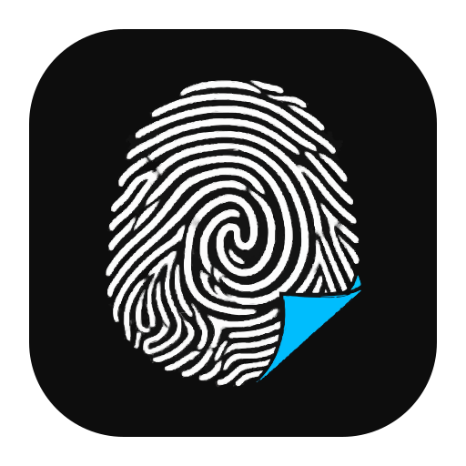
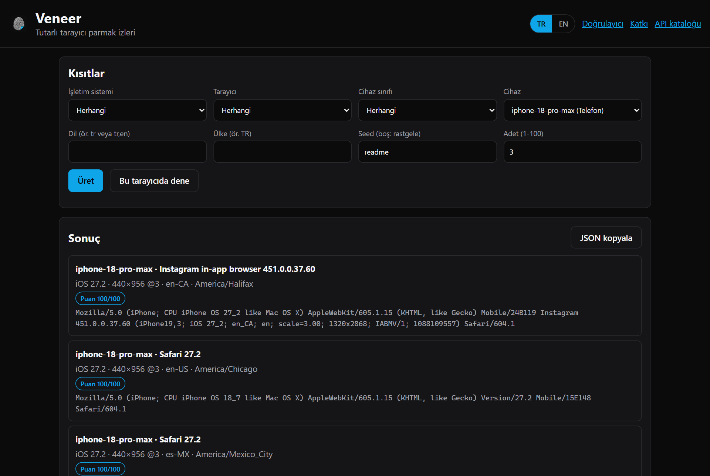
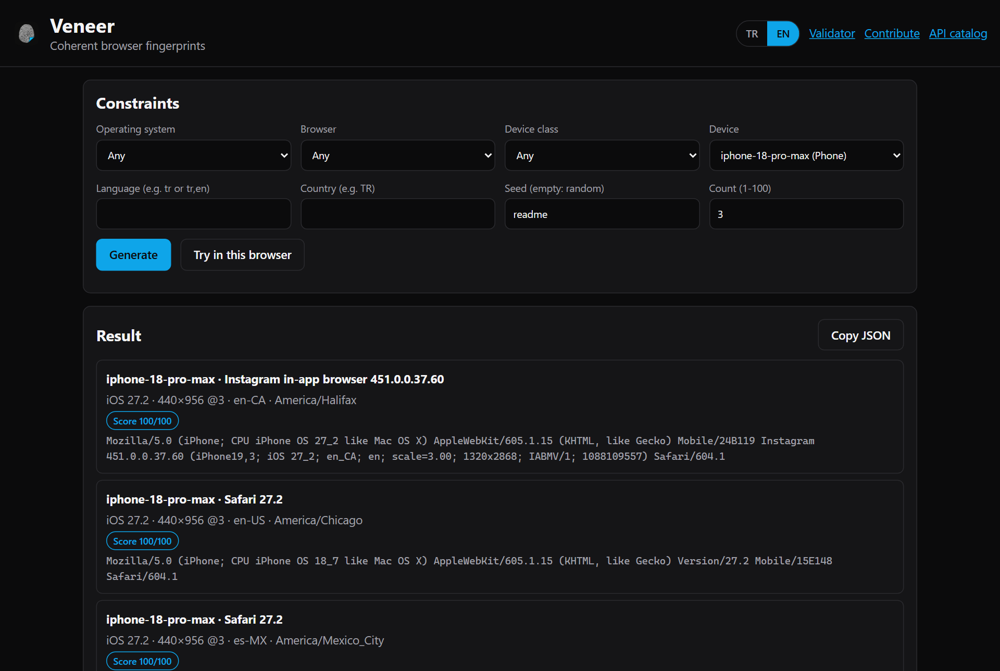
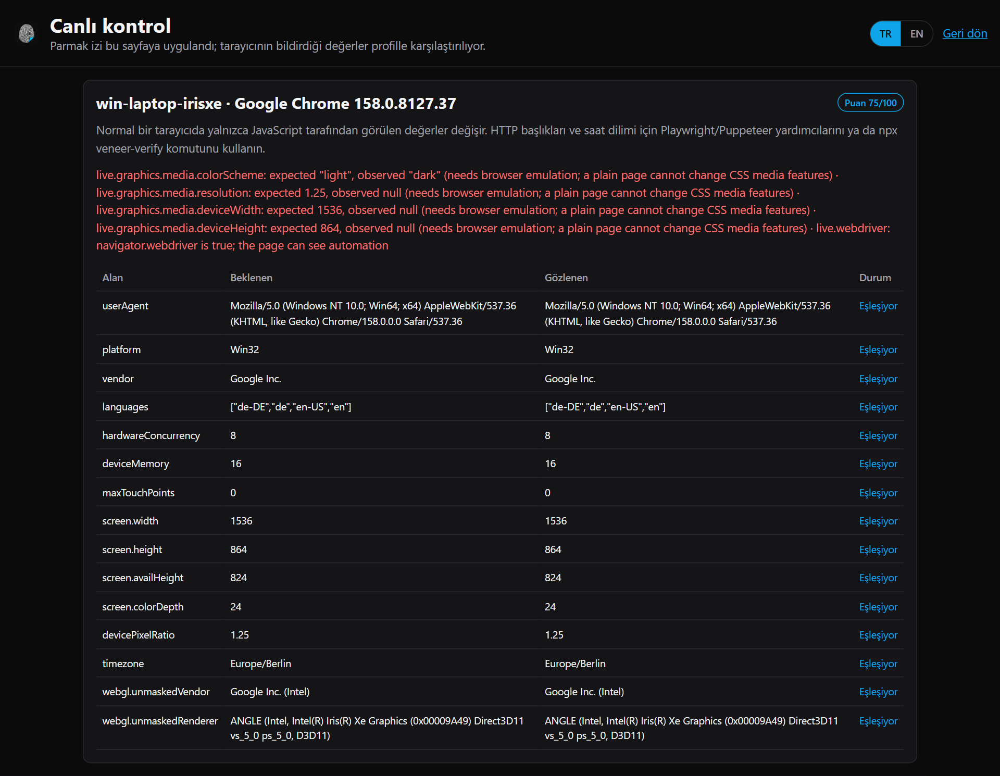
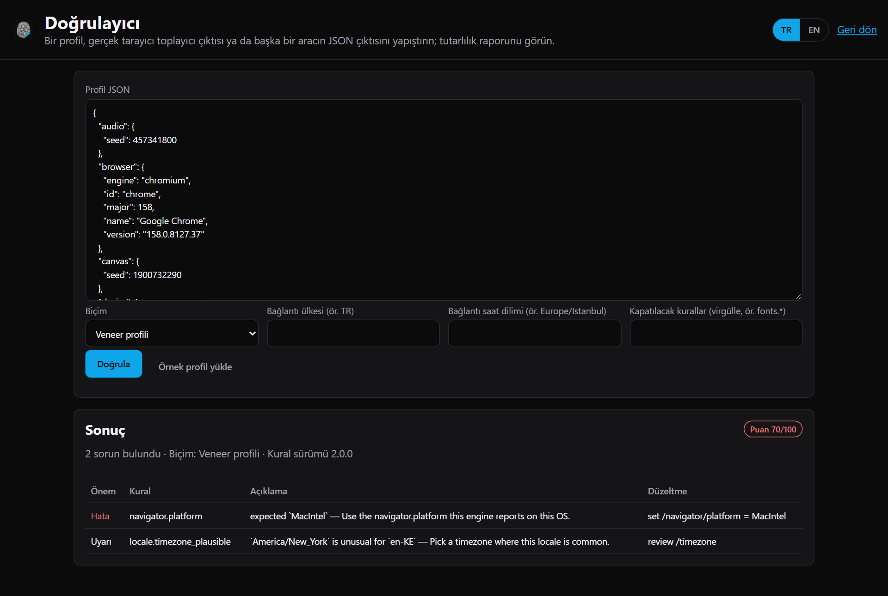
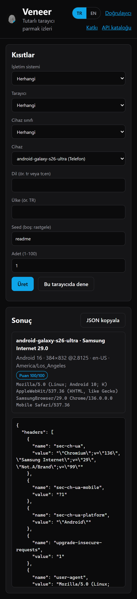

<p align="center">
  
</p>

<h1 align="center">Veneer</h1>

<p align="center">
  <strong>Playwright, Puppeteer, Selenium ve daha fazlası için tutarlı tarayıcı parmak izleri.</strong><br>
  User agent, client hints, ekran, WebGL, canvas, ses, fontlar, dil, saat dilimi ve HTTP başlıkları; tek bir inandırıcı ve kendi içinde tutarlı profil olarak üretilir ve gerçek bir tarayıcıda doğrulanır. Rust çekirdek, WASM, yerel HTTP API'li platformlar arası bir komut satırı aracı ve JavaScript, Python, Go, .NET ve Java binding'leri.
</p>

<p align="center">
  <a href="LICENSE"></a>
  
  
  
  
  
</p>

<p align="center">
  <a href="README.md">English</a> · <b>Türkçe</b>
</p>

<table>
  <tr>
    <td width="50%"></td>
    <td width="50%"></td>
  </tr>
  <tr>
    <td align="center">Türkçe arayüz</td>
    <td align="center">İngilizce arayüz</td>
  </tr>
</table>

---

## Neden Veneer

Parmak izi araçlarının çoğu her özelliği tek başına rastgele seçer. Sonuç: Apple GPU'lu bir Windows user agent'ı, telefonda 4K ekran, iPhone 8'de Safari 27 ya da `Asia/Tokyo` saat diliminde bir `en-US` tarayıcı. Tespit sistemlerinin tek bir değere bakmasına gerek yoktur — değerler arasındaki **çelişkilere** bakarlar.

Veneer gerçek bir cihaz, tarayıcı ve işletim sistemi sürümünü birlikte seçer, ardından tüm değerleri bu kombinasyondan türetir. Doğrulayıcı bunu kanıtlar: test paketi her çalıştırmada her işletim sistemi, her tarayıcı ve her cihaz için profil üretir ve tek bir tutarsızlıkta başarısız olur. Uçtan uca test paketi de gerçek tarayıcılar açarak sayfaların — FingerprintJS dahil — gerçekte ne gördüğünü kontrol eder.

| | Özellik bazlı rastgeleleştiriciler | Veneer |
| --- | --- | --- |
| Üretim | Birbirinden bağımsız rastgele seçimler | Gerçek cihaz + tarayıcı + işletim sistemi sürümünün birlikte örneklenmesi |
| Veri seti | Elle yazılmış listeler | 129 cihaz, 24 tarayıcı, 80 dil, 7,0 milyon farklı yapılandırma; her değerin kaynağı belli |
| Tutarlılık | Yok ya da gelişigüzel kontroller | Düzeltme önerili 60'tan fazla adlandırılmış kural, CI'da zorunlu |
| Canlı doğrulama | Elle | Gerçek tarayıcıda toplayıcı ve karşılaştırma, istek başlığı kontrolü, FingerprintJS çapraz kontrolü |
| Güncellik | Elle güncelleme | Haftalık iş, sürümleri resmi Chrome, Edge ve Firefox kaynaklarından çeker |
| Çalışma ortamı | Tek dil | Tek native çalıştırılabilir dosya (Windows, Linux, macOS), Rust crate, npm, Python, Go, .NET, Java |

## Özellikler

- **En eskisinden en yenisine her cihaz sınıfı.** iPhone 7 → iPhone 18 Pro Max; Galaxy S10 → S26 Ultra ve Z Fold8 / Fold8 Ultra (kapalı ve açık); Pixel 6 → 10; Xiaomi, Redmi, POCO, OnePlus, Motorola, OPPO, vivo; GTX 1060'tan RTX 4060'a ve Snapdragon X'e Windows PC'ler; Intel ve Apple Silicon Mac'ler (M1–M5); Linux dağıtımları; Chromebook'lar; iPad'ler; Fire tabletler; Steam Deck; ROG Ally; Xbox, PlayStation 5/4, Nintendo Switch; Fire TV, Samsung ve LG televizyonlar; Meta Quest 3.
- **İşletim sistemine uygun tarayıcılar.** iPhone 8 iOS 16.7 ve Safari 16.6 alır; iOS 26 ve sonrası dondurulmuş `iPhone OS 18_7` ifadesini kullanır; ChromeOS'taki Chrome platformun sabitlediği sürümü izler; iPad'ler dokunmatik noktalı Mac olarak görünür.
- **Uygulamaların gönderdiği haliyle özel user agent'lar.** Donanım model kodu, iOS build numarası, fiziksel çözünürlük ve dil içeren Google uygulaması (GSA), Instagram, Facebook, TikTok, X, LinkedIn ve LINE uygulama içi tarayıcıları; iOS için Chrome, Firefox ve Edge; Samsung Internet, Brave, Opera, Silk.
- **Gerçek tarayıcı davranışı.** Chromium'un birebir GREASE marka sırasıyla User-Agent Client Hints, Chromium 147+ `deviceMemory` aralıkları, Firefox'un `oscpu` değeri ve sadeleştirilmiş WebGL metinleri, Safari'nin tek dilli listesi.
- **Geniş tarayıcı API kapsamı.** Navigator, ekran, pencere geometrisi, yönlendirme, WebGL parametreleri ve eklentileri, WebGPU varlığı, canvas/OffscreenCanvas/ses/metin ölçüsü/DOMRect gürültüsü, medya cihazları, eklentiler ve PDF görüntüleyici, pil, ağ bilgisi, konuşma sesleri, klavye düzeni, depolama kotası, izinler, saat dilimi yedeği, fontlar, Web Worker ve SharedWorker.
- **Uyumlu HTTP başlıkları.** `sec-ch-ua`, motorun q değerleriyle `Accept-Language`, `Accept`, `Sec-Fetch-*` tarayıcı sırasıyla; yakalanan başlıklar ve HAR dosyaları için denetleyici.
- **Doğrulayıcı.** Sabit kural kimlikleri, her sorun için düzeltme, 0–100 puan, SARIF çıktısı, özel ve kapatılabilir kurallar, dağılım sapması analizi, kural kapsamı, başka araçlardan içe aktarma (fingerprint-suite ve düz JSON).
- **Yakalama.** Gerçek bir tarayıcının bildirdiklerinden tam profil oluşturup denetler.
- **Tekrarlanabilir.** Aynı seed, aynı profil, aynı canvas hash'i; paylaşılabilir kısa profil kimlikleri; tekrarsız toplu üretim.
- **İki dilli arayüz.** Üretici, canlı kontrol, doğrulayıcı ve katkı sayfaları Türkçe ve İngilizce.

## Kurulum

Windows, Linux ya da macOS için `veneer` çalıştırılabilir dosyasını [Releases](https://github.com/LLCForge/Veneer/releases) sayfasından indirin ya da derleyin:

```bash
cargo install --git https://github.com/LLCForge/Veneer veneer-cli
```

Kütüphaneler:

```bash
npm install @llcforge/veneer
```

```bash
cargo add veneer
```

Python, Go, .NET ve Java binding'leri [bindings/](bindings) altındadır ve [crates/veneer-ffi](crates/veneer-ffi) C ABI kütüphanesini kullanır.

## Komut satırı

```bash
veneer generate --device iphone-18-pro-max --browser gsa --locale tr
```

```bash
veneer generate --os android --count 20 --unique --format jsonl
```

```bash
veneer generate --engine gecko --gpu-vendor nvidia --country DE --min-width 1920 --full
```

```bash
veneer validate profile.json --output sarif
```

```bash
veneer headers --device android-galaxy-s26-ultra --format curl --url https://example.com
```

| Komut | Amaç |
| --- | --- |
| `generate` | Yeni profiller (`--full` başlıkları ve init script'i ekler, `--id` paylaşılan bir profili yeniden üretir) |
| `validate`, `rules`, `drift` | Profilleri denetler, kuralları listeler, bir grubu beklenen dağılımla karşılaştırır |
| `capture` | Gerçek tarayıcının toplayıcı çıktısından profil oluşturur |
| `script`, `collector` | Her otomasyon aracı için init script ve sayfa içi toplayıcı |
| `headers`, `check-headers`, `net` | HTTP istemcileri için başlıklar, yakalanan başlık kontrolü, JA4/proxy/WebRTC yardımcıları |
| `catalog`, `devices`, `diff` | Veri seti içeriği, cihaz tablosu, alan düzeyinde profil farkı |
| `pool` | Kullanım sayısı tutan dosya tabanlı profil havuzu |
| `pack`, `--data <dizin>` | Kendi cihaz/tarayıcı verinizi paketleyip çalışma anında yükleyin |
| `serve` | Web arayüzü ve HTTP API |
| `bench` | Bu makinede saniyede üretilen profil sayısı |

## HTTP API ve web arayüzü

```bash
veneer serve
```

`http://127.0.0.1:8787` adresini açar: üretici, canlı kontrol, doğrulayıcı ve katkı sayfası; ayrıca her istekte yeni üretilmiş ve doğrulanmış bir parmak izi döndüren JSON API.

| Uç nokta | Amaç |
| --- | --- |
| `GET /v1/fingerprint` | Yeni parmak izleri. Herhangi bir kısıt, `count` (1–100), `unique`, `id`, `include=headers,script` |
| `GET /v1/catalog` | Tüm işletim sistemi, tarayıcı, cihaz ve dil kimlikleri ile yapılandırma sayısı |
| `POST /v1/validate`, `/v1/check`, `/v1/sarif` | Profil doğrulama; seçeneklerle; SARIF olarak |
| `POST /v1/capture` | Toplayıcı çıktısından profil oluşturur ve denetler |
| `POST /v1/compare` | Gerçek tarayıcıdan gelen `{ profile, observed }` verisini karşılaştırır |
| `POST /v1/headers/compare` | Yakalanan istek başlıklarını profille karşılaştırır |
| `POST /v1/drift`, `GET /v1/rules` | Dağılım sapması; kural kapsamı |
| `GET /v1/script`, `/v1/collector.js` | Init script; sayfa içi toplayıcı |
| `GET /probe`, `/validate`, `/contribute` | Canlı kontrol, doğrulayıcı ve katkı sayfaları |

```bash
curl "http://127.0.0.1:8787/v1/fingerprint?device=android-galaxy-s26-ultra&locale=tr&include=headers"
```

Güvenlik: sunucu varsayılan olarak `127.0.0.1` adresine bağlanır; başka bir adres `--token` (ya da `VENEER_TOKEN`) gerektirir. Anahtar `Authorization: Bearer` ile gönderilir ya da web arayüzünde HttpOnly, SameSite=Strict bir çerezle değiştirilir. Yanıtlar sıkı bir Content-Security-Policy ve güvenlik başlıkları taşır, istek gövdeleri 64 KB ile sınırlıdır ve eşzamanlı istek sayısı kısıtlanır.

## Canlı doğrulama

<table>
  <tr>
    <td width="50%"></td>
    <td width="50%"></td>
  </tr>
  <tr>
    <td align="center">Canlı kontrol</td>
    <td align="center">Düzeltme önerili doğrulayıcı</td>
  </tr>
</table>

**Web arayüzünde**, "Bu tarayıcıda dene" parmak izini mevcut tarayıcınızdaki bir sayfaya uygular ve tüm değerleri karşılaştırır. Normal bir sekme yalnızca JavaScript tarafından görülen değerleri değiştirebilir; HTTP başlıkları ve CSS medya özellikleri otomasyon gerektirir ve sayfa bunları uyarı olarak işaretler.

**Gerçek otomatik tarayıcıyla**, `veneer-verify` uygun Playwright motorunu başlatır, profili (istek başlıkları ve medya emülasyonu dahil) uygular, canlı kontrol eder ve açık parmak izi test sitelerini açar:

```bash
npx veneer-verify --device android-galaxy-z-fold8-ultra --locale tr
```

Varsayılan siteler [CreepJS](https://abrahamjuliot.github.io/creepjs/), [BrowserLeaks](https://browserleaks.com/javascript) ve [bot.sannysoft.com](https://bot.sannysoft.com/)'dur; kendi sitelerinizi `--site` ile verin. Veneer `navigator.webdriver` değerini gizlemez, uyarı olarak raporlar.

## Kütüphane kullanımı

### Playwright

```typescript
import playwright from 'playwright'
import { generate, launchWithProfile, verifyPage } from '@llcforge/veneer'

const profile = generate({ os: 'macos', browser: 'chrome', locale: 'tr', seed: 'session-42' })
const { browser, page } = await launchWithProfile(playwright, profile)

await page.goto('https://example.com')
console.log(await verifyPage(page, profile))
await browser.close()
```

### Puppeteer

```typescript
import puppeteer from 'puppeteer'
import { generate, applyProfile } from '@llcforge/veneer'

const profile = generate({ os: 'windows', browser: 'chrome' })
const browser = await puppeteer.launch()
const page = await browser.newPage()
await applyProfile(page, profile)
await page.goto('https://example.com')
```

### Rust

```rust
fn main() -> Result<(), veneer::Error> {
    let profile = veneer::generate(&veneer::Constraints {
        device: Some("iphone-17-pro".into()),
        browser: Some("instagram".into()),
        seed: Some("session-42".into()),
        ..Default::default()
    })?;

    println!("{}", profile.navigator.user_agent);
    let report = veneer::validate(&profile);
    assert!(report.valid);
    Ok(())
}
```

### Entegrasyonlar

| Paket | Kullanım |
| --- | --- |
| [packages/playwright-fixture](packages/playwright-fixture) | Playwright Test: `test.use({ veneer: { os: 'macos' } })` |
| [packages/puppeteer-extra-plugin](packages/puppeteer-extra-plugin) | puppeteer-extra |
| [packages/selenium](packages/selenium) | Selenium WebDriver (CDP ve BiDi) |
| [packages/wdio-service](packages/wdio-service) | WebdriverIO |
| [packages/crawlee](packages/crawlee) | Crawlee tarayıcı havuzları |
| [packages/cypress](packages/cypress) | Cypress |
| [packages/cdp](packages/cdp) | Ham CDP ile her Chromium |
| [packages/electron](packages/electron) | Electron `webContents` |
| [packages/extension](packages/extension) | Elle test için Manifest V3 uzantısı |
| [bindings/python](bindings/python), [go](bindings/go), [dotnet](bindings/dotnet), [java](bindings/java) | Playwright Python, chromedp/rod, Playwright .NET, Playwright Java/Selenium |
| [docker/](docker) | Hazır Playwright + Veneer imajı |

Yeni projeler için şablonlar [examples/templates](examples/templates) altındadır.

## Kısıtlar

Tüm alanlar isteğe bağlıdır ve komut satırında (`--kebab-case`), API'de (sorgu parametreleri) ve kütüphanelerde (camelCase) aynı şekilde çalışır.

| Alan | Değerler |
| --- | --- |
| `os` | `windows`, `macos`, `linux`, `chromeos`, `android`, `ios`, `ipados`, `fireos`, `xbox`, `playstation`, `nintendo`, `tizen`, `webos`, `horizonos` |
| `browser` | `chrome`, `edge`, `firefox`, `safari`, `samsung`, `brave`, `opera`, `silk`, `chrome-ios`, `firefox-ios`, `edge-ios`, `gsa`, `instagram`, `facebook`, `tiktok`, `twitter`, `linkedin`, `line`, `playstation`, `playstation4`, `nintendo`, `samsung-tv`, `lg-tv`, `meta-quest` |
| `kind` | `desktop`, `laptop`, `phone`, `tablet`, `handheld`, `console`, `tv`, `vr` |
| `device` | birebir kimlik, ör. `iphone-18-pro-max`, `android-galaxy-s26-ultra` — bkz. `veneer devices` |
| `engine` | `chromium`, `gecko`, `webkit` |
| `gpuVendor` | GPU ile eşleştirilen metin, ör. `nvidia`, `apple`, `adreno` |
| `minVersion` / `maxVersion` | tarayıcı ana sürüm aralığı |
| `minWidth` … `maxDpr` | ekran boyutu ve piksel oranı aralıkları |
| `locale` | `tr-TR`, `tr` ya da `tr,en` gibi bir liste |
| `country` | ISO kodu, ör. `TR`, `US`, `DE` |
| `timezone` | IANA adı, ör. `Europe/Istanbul` |
| `seed` | herhangi bir metin; aynı seed, aynı profil |

iPhone 7'de Chrome ya da iOS'ta Firefox gibi imkânsız kombinasyonlar bozuk bir profil yerine açık bir hata döndürür.

<p align="center">
  
</p>

## Veri doğruluğu

Her veri grubu — sürümler, user agent biçimleri, model kodları, ekranlar, GPU metinleri, sesler, fontlar — kaynağı ve güven seviyesiyle birlikte [crates/veneer/data/SOURCES.md](crates/veneer/data/SOURCES.md) dosyasında listelenir. Doğrulanamayan değerler tahmin edilmek yerine dışarıda bırakılır. Cihaz sahipleri yardımcı olabilir: [docs/verification.md](docs/verification.md) gerçek veri göndermeyi anlatır, `veneer serve` de anonim bir `/contribute` sayfası içerir.

## Sınırlamalar

- Profile uyan motoru başlatın (`launchWithProfile` bunu yapar). Bir Chromium ikili dosyası inandırıcı şekilde Safari gibi davranamaz.
- TLS (JA3/JA4) ve HTTP/2 parmak izleri tarayıcı ikili dosyasından gelir; Veneer bunları belgeler ve kontrol eder ([docs/network](docs/network)) ama değiştiremez.
- Ana makinede olmayan fontlar eklenemez, stil dosyalarında tanımlanan fontlar gizlenmez. Service Worker'lar yamalanmaz.
- Chromium, emüle edilen `Accept-Language` başlığını gerçek Chrome'dan daha önce yerleştirir; `check-headers` bunu raporlar.
- Bazı konsol, TV, VR ve uygulama içi veriler düşük güvenilirliklidir; bkz. SOURCES.md.

## Proje durumu

Veneer **erken geliştirme** aşamasındadır. API `1.0` öncesinde değişebilir. Issue ve pull request'ler memnuniyetle karşılanır.

## Sorumlu kullanım

Veneer meşru işler için vardır: kendi sitelerinizi parmak izine karşı test etmek, gizlilik araştırması, farklı cihaz sınıflarında QA, robots.txt ve kullanım koşullarına uyan veri toplama ve test etmeye yetkili olduğunuz bot tespit sistemlerini değerlendirmek. Dolandırıcılık, hesap ele geçirme, reklam sahtekârlığı, yasak atlatma ya da yasayı veya bir hizmetin koşullarını ihlal eden herhangi bir faaliyet için kullanmayın. Nasıl kullandığınızın sorumluluğu size aittir.

## Dokümantasyon

- [ARCHITECTURE.md](ARCHITECTURE.md) — veri seti, üretici, eklentiler, doğrulayıcı, API ve script'lerin birbirine nasıl bağlandığı
- [docs/network](docs/network) — başlıklar, TLS, HTTP/2, HTTP/3, DNS-over-HTTPS, WebRTC, proxy konumu
- [docs/verification.md](docs/verification.md) — cihaz doğrulama ve veri katkısı
- [CONTRIBUTING.md](CONTRIBUTING.md) — geliştirme ortamı, kurallar, cihaz ekleme
- [SECURITY.md](SECURITY.md) — güvenlik açığı bildirme
- [CODE_OF_CONDUCT.md](CODE_OF_CONDUCT.md) — topluluk standartları

## Lisans

[MIT Lisansı](LICENSE) ile yayınlanmıştır. Atıf ve üçüncü taraf bilgileri için [NOTICE](NOTICE) dosyasına bakın.
